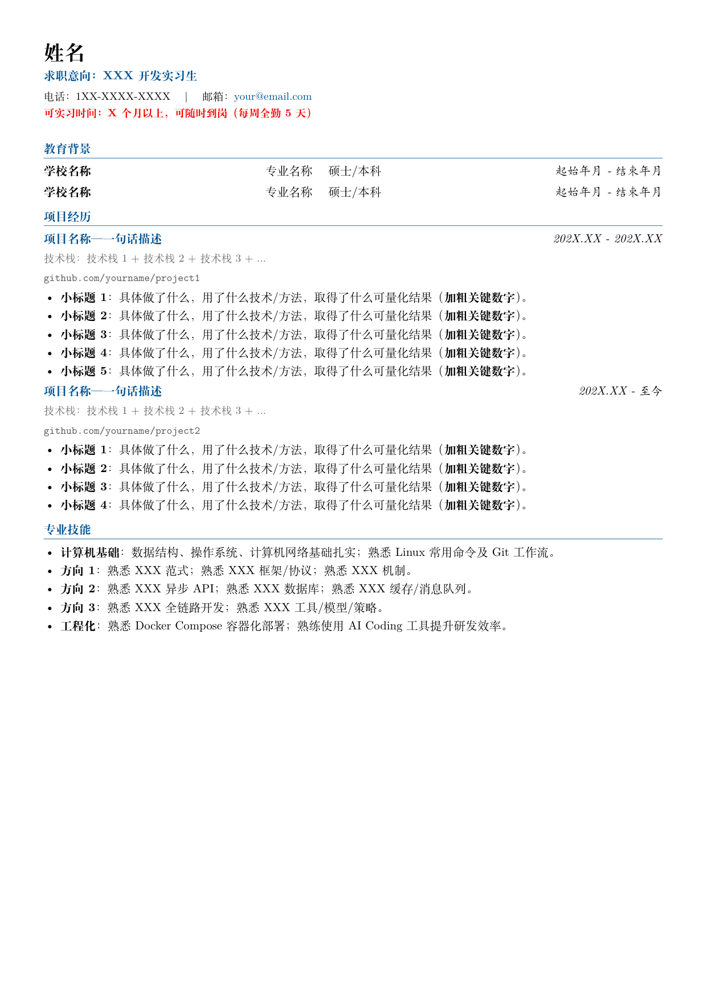

# LaTeX 中文简历模板

一页 A4 中文简历模板，适合实习 / 校招。推荐用 [Tectonic](https://tectonic-typesetting.github.io/) 编译，也支持 XeLaTeX 和 Overleaf。



[查看 / 下载预览 PDF](preview/resume_template.pdf)

> **最省事**：不想装 Tectonic？首先改完你的tex文件之后，可以直接文本复制下来，有kimi额度的话，把 `resume_template.tex` 交给 Kimi，直接在对话框说「用 Tectonic 把 resume_template.tex 编译成 PDF」即可。

## 特点

- 一页 A4，中文，蓝灰配色
- 头部信息、教育背景、项目经历、专业技能
- 可选证件照位置：有 `photo.jpg` 就加载，没有也能直接编译
- Tectonic 一条命令编译，Overleaf 也能直接用
- 所有姓名、电话、邮箱、学校、项目链接均为占位符
- `photo.jpg` 已加入 `.gitignore`，避免把真实照片提交到公共仓库

## 快速开始

### 1. 获取模板

```bash
git clone https://github.com/yourcplusplus/latex-resume-template.git
cd latex-resume-template
```

或者直接下载 `resume_template.tex`。

### 2. 安装 Tectonic

**Windows**

任选一种：

```powershell
winget install TectonicProject.Tectonic
```

或从 [Tectonic Releases](https://github.com/tectonic-typesetting/tectonic/releases) 下载 `tectonic-*-x86_64-pc-windows-msvc.zip`，解压后把 `tectonic.exe` 所在目录加入 PATH。

如果装了 Scoop，也可以：

```bash
scoop install tectonic
```

**macOS**

```bash
brew install tectonic
```

**Linux**

```bash
cargo install tectonic
# 或者用发行版包管理器，例如 apt / dnf / pacman
```

验证安装：

```bash
tectonic --version
```

### 3. 编译

```bash
tectonic -X compile resume_template.tex
```

输出：

```text
resume_template.pdf
```

第一次编译会从网络下载 TeX 宏包（`ctex`、Fandol 字体、`titlesec` 等），之后会走本地缓存。

如果编译失败，保留日志排查：

```bash
tectonic -X compile --keep-logs resume_template.tex
```

然后查看 `resume_template.log`。

### 4. 用 Overleaf（不想本地装 Tectonic）

1. 新建 Overleaf 项目，上传 `resume_template.tex`
2. 打开 Menu → Compiler → 选择 **XeLaTeX**
3. Recompile

模板已经把 `ctex` 设置为 `fontset=fandol`，Overleaf 不需要额外上传字体文件。

## 修改模板

需要替换的占位符：

- `姓名`
- `求职意向：XXX 开发实习生`
- `1XX-XXXX-XXXX`
- `your@email.com`
- `学校名称`、`专业名称`、`硕士/本科`、`起始年月 - 结束年月`
- `项目名称`、`github.com/yourname/project1`
- `技术栈1 + 技术栈2 + ...`
- `方向1 / 方向2 / 方向3`

常用自定义位置：

| 想改什么 | 改哪里 |
| --- | --- |
| 主色 / 灰色 | 导言区的 `primary` / `secondary` |
| 页边距 | `geometry` 的 `top/bottom/left/right` |
| 标题间距 | `\titlespacing{\section}` |
| 字体 | `ctex` 的 `fontset=fandol` 或 `fontset=windows` |
| 项目数量 | 复制 `\projectTitle` + `\projectTech` + `itemize` 块 |
| 照片 | 把 `photo.jpg` 放到根目录；不想留照片区域就删掉第二个 `minipage`，并把 `0.82\textwidth` 改成 `\textwidth` |

字体说明：

- `fontset=fandol`：跨平台最稳，Tectonic / Overleaf / Linux 都能直接编译
- `fontset=windows`：只在本机 Windows + XeLaTeX 且装有宋体/黑体时使用，视觉效果更接近 Windows 常见简历

## 隐私提醒

模板本身不含真实个人信息，全部是占位符。但填写真实内容后请注意：

- 不要把含真实姓名、电话、邮箱、学校、公司、项目链接的 `.tex` 或 PDF 提交到公共仓库
- 真实简历建议放在**私有仓库**，或者只保留在本地
- `photo.jpg` 已在 `.gitignore` 中；不要为了模板演示提交真实证件照
- PDF 元数据已设置 `pdfauthor={}`；如果你自己加了 `\author{...}`，分享前记得检查
- 分享 PDF 前，检查正文、超链接和 PDF 属性里是否包含不想公开的信息

## 文件结构

```text
latex-resume-template/
├── resume_template.tex      # 简历源码
├── README.md
├── LICENSE
├── .gitignore
└── preview/
    ├── resume_template.pdf  # 用 Tectonic 编译出的预览
    └── resume_template.png  # 首页预览图
```

## Tectonic 教程说明

本 README 已经包含安装、编译、排错和 Overleaf 替代方案，足够日常使用，不需要再维护一份单独的长教程。更多细节见官方文档：

- <https://tectonic-typesetting.github.io/>
- <https://github.com/tectonic-typesetting/tectonic>

## License

MIT，见 [LICENSE](LICENSE)。
